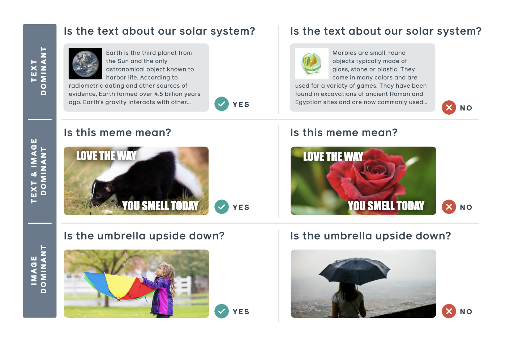

# HateReasoner: Detecting Hateful Memes via Presupposed Context Modeling and LLM-Guided Graph Reasoning

<p align="center">
  <strong>Minghao Li (Aiur), Yirui Liang (Loey), Qianqi Chen (Kiki)</strong>
</p>

<p align="center">
  Beijing Normal-Hong Kong Baptist University (BNBU)
</p>

<p align="center">
  <a href="https://suleynanauir.github.io/hateful-reasoner/">
    
  </a>
  <a href="assets/HatefulReasoner.pdf">
    
  </a>
</p>

<p align="center">
  
  
  
  
  
</p>

> **Beyond Image–Text Alignment: Understanding Implicit Hate through Contextual and Multimodal Reasoning.**

<p align="center">
  
</p>
---

## 📖 1. Overview

Hateful memes often convey implicit harmful meanings through the interaction between seemingly innocuous images and text. Such meanings may involve sarcasm, stereotypes, misleading claims, and implicit accusations, making them difficult to detect through conventional unimodal classification or superficial image–text alignment.

**HateReasoner** is a CLIP-based multimodal hateful meme detection framework that integrates presupposed context modeling, LLM-guided semantic reasoning, and graph-based multimodal learning.

The framework captures both global contextual dependencies and fine-grained cross-modal relationships for context-aware hateful meme classification.

---

## 🧩 2. Framework & Key Contributions

| Component | Description |
| :--- | :--- |
| **Image Preprocessing** | Integrates OCR, EAST text detection, and Big-LaMa image inpainting to reduce textual interference and reconstruct visual context. |
| **CLIP-Based Encoding** | Extracts global image–text embeddings and local patch–token representations within a shared semantic space. |
| **Presupposed Context Module (PCM)** | Models global image–text interactions through modality-specific transformations and element-wise feature multiplication. |
| **Semantic Guidance Module (SGM)** | Introduces LLM-derived semantic priors to emphasize relevant visual and linguistic cues. |
| **Graph-based Multimodal Module (GMM)** | Constructs multimodal graphs connecting image patches and text tokens for relational reasoning through GNNs. |
| **Semantic-Context Fusion Module (SCFM)** | Integrates semantic guidance and graph-based reasoning with global contextual features for final classification. |

### Core Workflow

```text
Image & Text Input
        ↓
OCR · Text Masking · Big-LaMa Inpainting
        ↓
CLIP-Based Multimodal Encoding
        ↓
PCM + SCFM (SGM + GMM)
        ↓
Multimodal Feature Fusion
        ↓
Hateful / Non-Hateful Classification
```

---

## 📊 3. Experimental Results

The research manuscript reports an evaluation on the **Hateful Memes Challenge (HMC)** dataset using Accuracy and AUROC as the primary evaluation metrics.

| Model | Accuracy (%) ↑ | AUROC (%) ↑ |
| :--- | ---: | ---: |
| Human Annotators | 84.70 | 82.65 |
| Image-grid | 52.00 | 52.63 |
| Image-region | 52.13 | 55.92 |
| Text BERT | 59.20 | 65.08 |
| Late Fusion | 59.66 | 64.75 |
| Concat BERT | 59.13 | 65.79 |
| MMBT-grid | 60.06 | 67.92 |
| MMBT-region | 60.23 | 70.73 |
| ViLBERT CC | 61.10 | 70.03 |
| Visual BERT COCO | 64.73 | 71.41 |
| GPT-4o mini | 69.50 | 75.02 |
| **HateReasoner (Ours)** | **73.40** | **77.99** |

HateReasoner achieves a reported **73.40% Accuracy** and **77.99% AUROC**, outperforming the automated baselines listed in the manuscript.

Compared with GPT-4o mini:

- **Accuracy:** +3.90 percentage points
- **AUROC:** +2.97 percentage points

For detailed methodology and experimental configurations, please refer to the [Research Paper](assets/HatefulReasoner.pdf).

---

## 💻 4. Installation & Data Preparation

### Environment Setup

Use Python 3.11 and install a PyTorch build compatible with your CUDA GPU.

```bash
python -m pip install -r requirements.txt
```

### Dataset Preparation

Prepare the Hateful Memes Challenge dataset following [data/README.md](data/README.md).

The preprocessing pipeline supports original, masked, and inpainted image variants. Reference notebooks are available in `data_preprocess/`.

### API Configuration

For LLM-backed pipelines:

```bash
export OPENAI_API_KEY="YOUR_API_KEY"
```

When using an alternative OpenAI-compatible provider:

```bash
export OPENAI_BASE_URL="YOUR_API_BASE_URL"
```

Do not commit API credentials to the repository. API-based pipelines may transmit inputs to the configured provider and incur usage costs.

---

## 🚀 5. Training

### Training Entry Points

| File | Description |
| :--- | :--- |
| `new_main_enhanced.py` / `new_engine_enhanced.py` | Enhanced multimodal reasoning pipeline |
| `new_main_LLM.py` / `new_engine_LLM.py` | LLM-guided model variant |
| `main.py` / `engine.py` | Original classification baseline |
| `pretraining/` | Representation pretraining and projection extraction |

### Quick Start

```bash
python new_main_enhanced.py \
    --dataset inpainted \
    --labels original \
    --batch_size 16 \
    --max_epochs 1 \
    --wandb_mode offline
```

For additional training arguments:

```bash
python new_main_enhanced.py --help
```

### Implementation Notes

- Datasets, pretrained weights, checkpoints, and training logs are not included in this repository.
- The enhanced implementation obtains semantic priors through a text-embedding API, rather than reproducing every prompt-based operation described in the manuscript.
- Full training has not been revalidated in a fresh environment.
- The enhanced pipeline currently evaluates both evaluation and test splits during training. Some logging and checkpoint options are not connected to the Trainer. Independent test evaluation is recommended for rigorous benchmarking.

---

## 🙏 Acknowledgements

This project builds upon CLIP, EAST, Big-LaMa, Hate-CLIPper, and the Hateful Memes Challenge benchmark.

The academic project page follows the NEXUS4SCI-Mat project-page structure and the Academic Project Page Template. The website adaptation is licensed under CC BY-SA 4.0; third-party research assets retain their respective rights.
